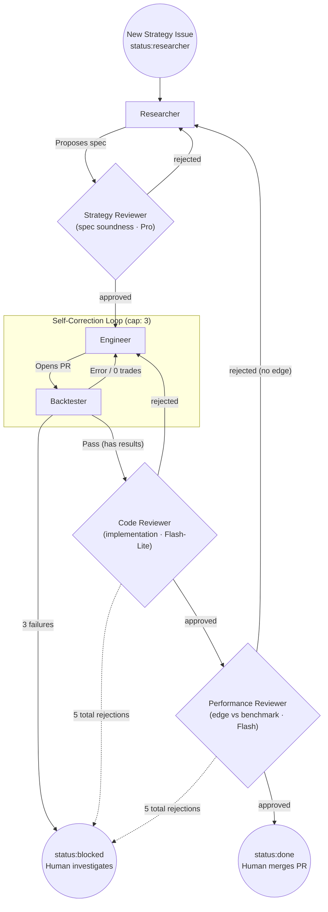

# 🤖 AI Trading Bot Team

A personal learning project: a simple algorithmic trading "team" built as a set of AI agents
(Researcher, Engineer, Reviewer) plus a deterministic Backtester, coordinated through GitHub
Issues. The **goal is to learn multi-agent orchestration patterns** — the trading logic itself
is secondary. The agents do the work; a human reviews and merges.

## Architecture at a glance

- **Framework:** [LangGraph](https://langchain-ai.github.io/langgraph/) — stateful agent
  workflow. Here it acts as a thin router: each issue's `status:` label decides which node runs.
- **Models:** Google AI Studio free tier, tiered by role (see `llm.py`). Pro is reserved for the one
  hardest reasoning task — the **Strategy Reviewer** (spec soundness) runs on `gemini-2.5-pro` (with a
  fallback to `gemini-3-flash`), firing once per research iteration so its rate limit is comfortable.
  Researcher, Engineer, and the **Performance Reviewer** (edge vs benchmark) run on `gemini-3-flash`;
  the **Code Reviewer** (mechanical checks) on the cheaper `gemini-3.1-flash-lite`. The architecture
  compensates for light models with rigid checklist prompts and deterministic verification (the Backtester).
- **Coordination layer:** GitHub Issues as the ticket board and primary state. Agents read/write
  comments, flip `status:` labels, and open Pull Requests. The human merges.
- **Persistence:** SQLite (`SqliteSaver`) checkpoints LangGraph thread state so internal agent
  history survives restarts. Constraint: `thread_id == issue_number`.

## Agent workflow



## Agent roles

| Agent | Type | Responsibility |
| :--- | :--- | :--- |
| **Researcher** | LLM | Turns a manager objective into an explicit strategy spec (hypothesis, entry/exit, sizing). |
| **Strategy Reviewer** | LLM (Pro) | Reviews the *spec* for soundness (look-ahead in logic, overfitting, vague rules, risk controls) before any code is written. Rejections → Researcher. |
| **Engineer** | LLM | Translates the approved spec into runnable Python (`pandas` / `pandas_ta` / `yfinance`), commits to a branch, opens a PR. |
| **Backtester** | Deterministic | Statically validates the interface, runs the code in a sandboxed subprocess, parses metrics, and enforces the 3-retry self-correction cap. |
| **Code Reviewer** | LLM (Flash-Lite) | Owns implementation quality: contract compliance, look-ahead bias in code, faithfulness to spec, correctness. Rejections → Engineer. Absorbs the bug-fix churn loop. |
| **Performance Reviewer** | LLM (Flash) | Judges *edge*: does the backtested strategy beat its buy-and-hold benchmark on a risk-adjusted basis? Rejections → Researcher; approval → `status:done`. |
| **Manager** | Human (you) | Sets objectives by opening issues, and performs the final review by merging (or rejecting) the PR. |

The flow has **no intermediate human gates** — agents run end-to-end until the code is either
ready to merge (`status:done`) or stuck (`status:blocked`). The human's review *is* the PR merge.

> **Note:** A Risk Manager and a Historian (performance-manifest archivist) existed in earlier
> versions and are intentionally **not** part of the current pipeline. Risk review now lives in the
> Reviewer. They may be reintroduced later.

## Key features

- **GitHub as the state machine & UI** — transparent audit trail via Issues, `status:` labels, and PR comments.
- **TDD for LLMs** — every strategy must actually execute and produce metrics (the Backtester) before any qualitative review.
- **Bounded self-correction** — the Engineer ⇄ Backtester loop is capped at 3 attempts, then escalates to a human (`status:blocked`).

## Getting started

### Prerequisites
- Python 3.10+
- GitHub Personal Access Token (fine-grained, `repo` scope on this repo)
- Google AI Studio (Gemini) API key

### Installation
1. Clone the repo.
2. Create a `.env` file:
   ```env
   GITHUB_TOKEN=your_token
   GITHUB_REPO=username/trading-bot-team
   GOOGLE_API_KEY=your_gemini_key
   ```
3. Install dependencies:
   ```bash
   pip install -r requirements.txt
   ```
4. Initialise GitHub labels:
   ```bash
   python scripts/setup_labels.py
   ```
5. (Optional) seed an example strategy issue:
   ```bash
   python scripts/create_first_issue.py
   ```
6. Start the orchestrator:
   ```bash
   python main.py
   ```

## Documentation

- [`DEVELOPER_GUIDE.md`](DEVELOPER_GUIDE.md) — technical invariants and the Engineer ⇄ Backtester contract
- [`docs/architecture.md`](docs/architecture.md) — high-level design and decisions
- [`docs/roles.md`](docs/roles.md) — agent role definitions
- [`docs/lifecycle.md`](docs/lifecycle.md) — strategy development lifecycle
- [`docs/ticket-schema.md`](docs/ticket-schema.md) — GitHub Issues labels & schema
- [`docs/setup.md`](docs/setup.md) — dev machine setup

## Next steps

1. **Historian / Portfolio Manager:** reintroduce metric archiving to a `performance_manifest.csv`, then select strategies by Sharpe/volatility.
2. **Unified execution engine:** run multiple approved strategies against live/paper data.
3. **Alpaca integration:** connect the execution engine for real-time paper trading.

## Out of scope

Real-money trading, real-time data feeds, and production deployment.
