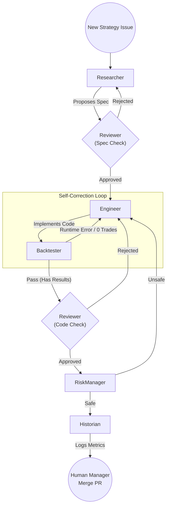

# trading-bot-team
# 🤖 AI Trading Bot Team

A personal learning project: a simple algorithmic trading bot built as a team of AI agents (researcher, engineer, reviewer) coordinated by me as the manager. The goal is to learn multi-agent orchestration patterns — the trading logic itself is secondary.
A multi-agent autonomous system built with **LangGraph** and **GitHub Issues** designed to research, implement, and validate trading strategies. This project demonstrates advanced agentic workflows, including self-correction loops and test-driven development (TDD) patterns for LLMs.

## Architecture at a glance
## 🏗️ System Architecture

- **Framework:** LangGraph (stateful agent workflows with human-in-the-loop checkpoints)
- **Models:** Gemini 3.1 Flash Lite (Google) used across all roles for cost-efficiency.
- **Coordination layer:** GitHub Issues as a ticket board — agents read and write issues, I act as the manager
- **Workflow:** Pull Request-based implementation loop. Automated backtesting via subprocess execution.
The system uses GitHub as its state machine and user interface. Agents communicate by posting comments, updating labels, and opening Pull Requests.

## Status
### Agent Workflow Diagram

**Active Development.** Core orchestration loop is functional.
- Researcher, Engineer, Reviewer, Risk Manager, and Product Manager agents are implemented.
Active Development.** Core orchestration loop is functional.
- Researcher, Engineer, Reviewer, and Risk Manager agents are implemented.
- Automated Backtester node is operational.
- GitHub issue-to-PR workflow is established.
The following diagram illustrates the relationship between agents and the iterative feedback loops that ensure code quality and strategy performance.

## Documentation


- [`docs/architecture.md`](docs/architecture.md) — high-level design and decisions
- [`docs/roles.md`](docs/roles.md) — agent role definitions and model assignments
- [`docs/ticket-schema.md`](docs/ticket-schema.md) — planned GitHub Issues schema
- [`docs/setup.md`](docs/setup.md) — how to set up a dev machine
- `docs/prompts/pm_ideation.md` — prompt for strategy ideation & system context
## 👥 Agent Roles

## Next steps
| Agent | Responsibility |
| :--- | :--- |
| **Researcher** | Analyzes market objectives and proposes formal strategy specifications (Hypothesis, Entry/Exit rules). |
| **Engineer** | Translates approved specs into production-grade Python code using `pandas` and `yfinance`. |
| **Backtester** | A deterministic node that executes the strategy in a sandbox, extracting metrics and ensuring the code is functional. |
| **Reviewer** | Performs qualitative QA on both strategy logic (spec) and code implementation (Pull Requests). |
| **Risk Manager** | Evaluates strategies for safety, checking position sizing, stop-loss logic, and overfitting risks. |
| **Historian** | Archives successful backtest results into a central performance manifest for portfolio tracking. |

1. **Portfolio Manager:** Build a script that parses the `performance_manifest.csv` and selects strategies based on Sharpe/Volatility.
2. **Unified Execution Engine:** Develop a wrapper to run multiple strategies in parallel against live/paper market data.
3. **Alpaca Integration:** Connect the execution engine to Alpaca for real-time paper trading.
## 🛠️ Key Features

- **LangGraph Orchestration:** Stateful workflow management allowing for complex transitions and conditional routing.
- **GitHub as a UI:** Leverages GitHub Issues, Labels (`status:`), and Comments for a transparent audit trail.
- **TDD Workflow:** Strategies are automatically backtested before being reviewed by the Risk Manager, ensuring the team only evaluates working code.
- **Multi-Model Support:** Configurable via `llm.py` to use different models (e.g., Gemini 1.5 Pro/Flash) for producers vs. reviewers.

## 🚀 Getting Started

### Prerequisites
- Python 3.10+
- GitHub Personal Access Token
- Google AI Studio (Gemini) API Key

### Installation
1. Clone the repository.
2. Create a `.env` file:
   ```env
   GITHUB_TOKEN=your_token
   GITHUB_REPO=username/trading-bot-team
   GOOGLE_API_KEY=your_gemini_key
   ```
3. Install dependencies:
   ```bash
   pip install -r requirements.txt
   ```
4. Initialize GitHub labels:
   ```bash
   python setup_labels.py
   ```
5. Start the orchestrator:
   ```bash
   python main.py
   ```
